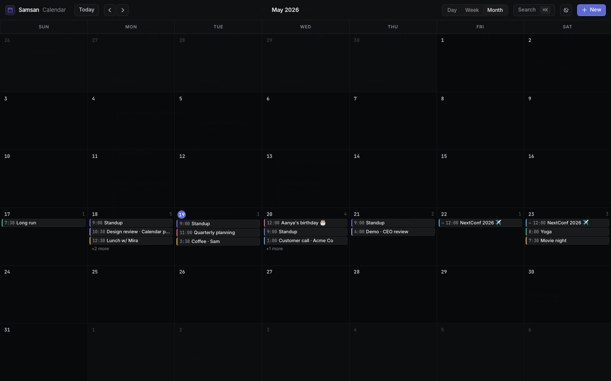
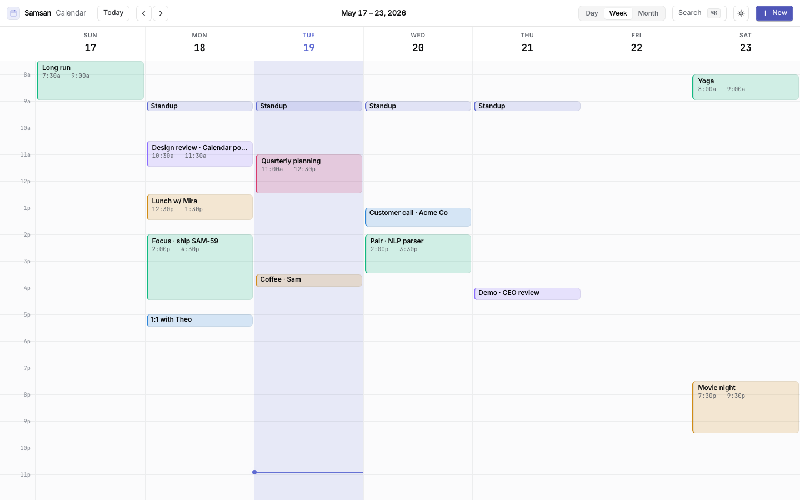
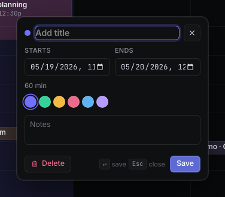

# Samsan Calendar

A local-first, modern web calendar. Linear / Vercel / Raycast aesthetic, zero backend,
all data stored in IndexedDB. Month / week / day views, drag-to-reschedule,
drag-edge-to-resize, keyboard-first navigation.

Built with **Vite + React 19 + TypeScript + Tailwind v4 + Zustand + idb**.



Lighthouse desktop scores (median of 3 runs, `dist/index.html`):
**Performance 0.99 · Accessibility 1.00 · Best Practices 1.00 · SEO 1.00**.
Audit runs in CI on every PR — budgets in [`lighthouserc.json`](lighthouserc.json).

---

## Quickstart

```bash
make setup      # pnpm install --frozen-lockfile
make dev        # http://localhost:5173
```

Or directly:

```bash
pnpm install
pnpm dev
```

## What's inside

```
src/
  components/     # MonthView, TimeGrid (week + day), EventEditor, TopBar, Hotkeys
  lib/            # date, colors, layout, storage (IDB), seed
  store/          # zustand store (events, view, theme, hotkeys)
  types.ts        # CalendarEvent, View, Theme
```

| Concern              | Where                              |
| -------------------- | ---------------------------------- |
| Persistence (IDB v1) | `src/lib/storage.ts`               |
| Date math            | `src/lib/date.ts` (date-fns)       |
| Event layout         | `src/lib/layout.ts`                |
| Color tokens         | `src/lib/colors.ts`                |
| State                | `src/store/calendar.ts` (Zustand)  |
| Hotkeys              | `src/components/Hotkeys.tsx`       |

## Keyboard shortcuts

| Key       | Action               |
| --------- | -------------------- |
| `j` / `k` | navigate back / fwd  |
| `n`       | new event            |
| `t`       | jump to today        |
| `m`       | switch to month view |
| `w`       | switch to week view  |
| `d`       | switch to day view   |
| `Esc`     | close editor / modal |

## Import & export

Open the command palette (`⌘K`) for standards-compliant `.ics` (RFC 5545)
round-trips:

- **Export all events to .ics** — the whole calendar in one file.
- **Export this view to .ics** — only what's on screen: the visible day,
  week, month, or the agenda's 60-day window. The filename records the view
  and cursor date, e.g. `samsan-calendar-week-2026-09-14.ics`.
- **Import events from .ics** — upload a calendar file; simple recurring
  series are re-expanded into masters with their `RRULE` intact.

Recurring events export as a single `VEVENT` carrying the `RRULE` — the
expanded occurrences you see in the grid are never duplicated into the file.

## Scripts

| Command          | What it does                                     |
| ---------------- | ------------------------------------------------ |
| `pnpm dev`       | Vite dev server on `:5173`                       |
| `pnpm build`     | `tsc -b --noEmit && vite build` → `dist/`        |
| `pnpm preview`   | Serve the production build on `:5173`            |
| `pnpm typecheck` | `tsc -b --noEmit`                                |
| `pnpm test:data` | Smoke-test the IDB + zustand + seed data layer   |
| `make lighthouse`| Build + run Lighthouse CI locally (budgets in `lighthouserc.json`) |
| `make clean`     | Wipe `dist/`, `node_modules/`, LHCI artifacts    |

## Data layer (SAM-59)

The calendar is local-only. Every event lives in IndexedDB; every selector that
the views render against is a pure function over the in-memory zustand mirror.
Other slices (design polish, NLP, views) can rely on this contract without
re-implementing storage plumbing.

| Module                              | Purpose                                                   |
| ----------------------------------- | --------------------------------------------------------- |
| `src/lib/storage.ts`                | IDB wrapper: `events` store + `by-start`/`by-end` indices, `meta` keyval store, `loadEventsInRange(startMs, endMs)` range query, `putEvents()` batch write. Schema v2 with auto-migration from v1. |
| `src/lib/seed.ts`                   | `buildSeedEvents(anchor)` — deterministic week of ~18 demo events (standups, lunches, focus blocks, all-day birthday, multi-day conference). All events tagged `seeded: true`. |
| `src/store/calendar.ts`             | Zustand store. `hydrate()` is the single boot call — it loads IDB into memory and, on first launch, runs the demo seed gated by the `seed.v1` meta key (never re-seeds once flipped). Also owns CRUD, drag snapshots, undo/redo, theme, palette. |
| `src/store/selectors.ts`            | Pure selectors over the in-memory `events` map — `selectEventsInRange`, `selectEventsForDay`, `selectAllDayForDay`, `selectTimedForDay`, `sortByStart`. Zero IDB, zero zustand — safe to unit-test in plain Node. |
| `tests/data.smoke.test.ts`          | `pnpm test:data` — fake-indexeddb-backed contract tests: auto-seed, idempotent re-hydrate, CRUD round-trip through IDB, undo/redo persistence, range-query correctness, seed determinism. |

Anything else that wants to read events should call the selectors. Anything
that writes events should call the store actions (`createEvent`, `updateEvent`,
`upsertEvent`+`persistEvent` for drags, `deleteEvent`) — never `dbPut` directly,
or you'll lose the undo stack.

## Screenshots

Month view, dark theme:


Week view, light theme:



Inline event editor with color picker:



> Regenerate with `pnpm dev` running, then `node scripts/capture-screenshots.mjs`
> (Playwright drives Chromium at 1440×900). See
> [`docs/screenshots/README.md`](docs/screenshots/README.md) for the manual recipe.

## CI

Two workflows in `.github/workflows/calendar.yml`:

1. **build** — typecheck, build, upload `dist/` artifact.
2. **lighthouse** — build, run `@lhci/cli autorun` against the static `dist/`,
   fail if Performance / Accessibility / Best Practices drop below **95** or
   SEO drops below **90**. Reports uploaded as a workflow artifact.

Budgets live in [`lighthouserc.json`](lighthouserc.json) at the repo root.
Workflow is gated to PRs and pushes to `main`. Concurrency is per-ref with
`cancel-in-progress` so superseded runs are killed automatically.

### Lighthouse — most recent local run

Run: `make lighthouse` (Chrome, desktop preset, 3 passes, `dist/index.html`).

| Category        | Score (worst of 3 runs) | Budget |
| --------------- | ----------------------- | ------ |
| Performance     | **0.99**                | ≥ 0.95 |
| Accessibility   | **1.00**                | ≥ 0.95 |
| Best Practices  | **1.00**                | ≥ 0.95 |
| SEO             | **1.00**                | ≥ 0.90 |

Core Web Vitals (median): LCP 0.7s · TBT 0ms · CLS 0. Bundle: 21 kB CSS gz 5.6 kB
+ 395 kB JS gz 115 kB.

## Design notes

- **One accent color.** Indigo. Surfaces, not boxes. Hairline borders, no
  drop shadows except on hover. See `src/index.css` design tokens.
- **Phosphor duotone icons** throughout.
- **Inter + JetBrains Mono** (latter for time digits only).
- **View transitions** via the View Transitions API; falls back to plain
  swap when unsupported.

## Why

A calendar shouldn't look like Google Calendar 2014. Linear's team makes
software that feels weightless. This is the calendar they'd ship if they
made one.

## License

Private. Internal Samsan project.

## Terms & Disclaimer

By using this project you agree to the following.

- **No warranty.** This software is provided "as is", without warranty of any kind, express or implied, including merchantability, fitness for a particular purpose, and non-infringement.
- **No liability.** To the maximum extent permitted by law, the author and contributors are not liable for any claim, loss, or damage (direct, indirect, incidental, or consequential, including lost data or profits) arising from its use.
- **Your responsibility.** You use it at your own risk and are responsible for complying with the laws that apply to you.
- **Your data.** Keep backups; data loss is possible. If you process other people's personal information, you are responsible for complying with privacy laws such as US state privacy laws (e.g. CCPA), PIPEDA and Quebec's Law 25 (Canada), and the Digital Personal Data Protection Act, 2023 (India).
- **Third parties.** Names, logos, APIs, and services of others belong to their owners and are used for identification only; no affiliation or endorsement is implied.
- **Your statutory rights.** Nothing here limits rights that cannot be waived by agreement, including under consumer-protection laws in the USA, Canada (including Quebec), and India (Consumer Protection Act, 2019).
- **License.** Use, copying, and distribution are governed by the [LICENSE](LICENSE) file; if anything here conflicts with it, the license controls.

## Content, Assets & Fair Use

- **Original work.** Unless noted otherwise (including below), the code, text, design, and images in this repository were created by the author.
- **Libraries, fonts, and icons.** Third-party libraries, fonts (for example Google Fonts), and icon sets belong to their creators and are used under their own licenses; see the dependency manifests and each source for terms.
- **Logos, brands, and screenshots.** Third-party names, logos, and screenshots appear only to identify or describe their products (nominative use). They remain the property of their owners and do not imply affiliation or endorsement.
- **Ideas and inspiration.** Where this project is inspired by another product, game, or idea, it is an independent implementation. It borrows only general ideas, mechanics, or styles, which are not anyone's exclusive property, and is meant to contain no third-party code or artwork used without permission.
- **Fair use and fair dealing.** Any third-party material is used in limited ways for purposes such as education, research, review, commentary, or identification, relying on fair use in the USA (17 U.S.C. § 107), fair dealing in Canada (Copyright Act, ss. 29–29.2), and fair dealing in India (Copyright Act, 1957, s. 52), where they apply.
- **Concerns and takedown requests.** If you own rights in something here and believe it is used improperly, [open an issue](https://github.com/Sanjays2402/samsan-calendar/issues) or contact the author through their GitHub profile with a link to the material and your claim. It will be reviewed promptly and credited, changed, or removed as appropriate. You may also use GitHub's DMCA process.
- **Contributions.** By contributing, you confirm you have the right to submit your contribution and agree it is licensed under this repository's license.
